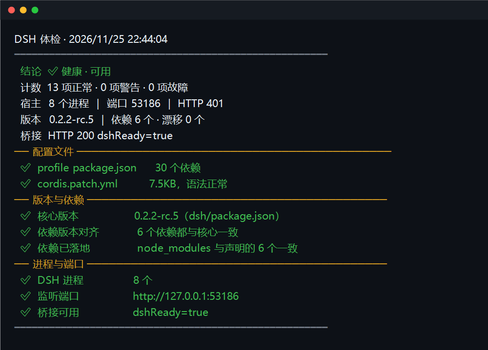

# dsh-doctor · DSH 急救箱



给 [DeepSeek Harness](https://github.com/deepseek-ai)（DSH，社区叫「大肥鱼」）做体检与修复的插件。

**修复引擎不依赖 DSH。** DSH 挂掉、插件对不上、页面打不开的时候，双击桌面上的 `repair.cmd` 照样能修。

```
症状：进程还在，端口也开着，err 日志是空的，但就是用不了
     → 这不是玄学，八成是插件依赖被装成了别的版本
     → dsh-doctor 会认出来，把版本对齐、重装、必要时重启
```

## 为什么会有它

2026-11-24，给 DSH 装三个官方实验包时，`install_bundle` 把依赖装成了 `0.2.1-alpha.2`，而主体是 `0.2.2-rc.5`。重启之后：进程起来了、新端口开了、err 日志干净，插件 API 却对不上——等于不能用。

那次是靠人一行行改依赖、手工重装才修好的。这个插件把那次的处置固化下来，并且加了两条从那以后一直有效的判断：

1. **核心版本只信 `app.asar`**。日志会过期（DSH 自己重启时没人写它），profile 里的「多数派」更会骗人：整批装错时它们互相印证错误。
2. **「能用」看桥接的 `dshReady`，不是看进程在不在**。进程 + 端口 + `401` 全绿，仍然可能是坏的。

## 它查什么

| 检查 | 说明 |
|---|---|
| profile 文件 | `package.json` 能否解析、`cordis.patch.yml` 的 YAML 有没有坏 |
| 核心版本 | 从 `app.asar` 读 `@deepseek-ai/dsh-desktop-runtime` |
| 依赖版本 | profile 里 `@deepseek-ai/dsh-*` 是否都等于核心版本 |
| 依赖落地 | `node_modules` 是否与 `package.json` 声明一致 |
| 进程 / 端口 / HTTP | 有没有主进程（会区分 Electron 子进程）、有没有监听、`/api/sessions` 回不回话 |
| 桥接 | `dshReady` 是否 true、桥接写的端口和 DSH 实际端口是否一致 |
| 日志 / 磁盘 / 快照 | 启动错误、C 盘空间、有没有可用快照 |

## 它修什么

1. **配置快照** —— 动手前先存 `package.json` + `cordis.patch.yml`（默认保留 30 份）
2. **版本漂移** —— 对齐到 `app.asar` 里的核心版本（改前留 `.bak-doctor-*`）
3. **重装依赖** —— 用 DSH 自带的 pnpm 在 profile 里 `pnpm install`
4. **恢复坏配置** —— 从最近快照恢复，再重装
5. **重启 DSH** —— 杀掉进程树、拉起、等新端口、刷新 `dsh-web-url.txt`
6. **桥接端口** —— `dsh.baseUrl` 对齐实际端口（**UTF-8 无 BOM**，否则桥接读不动）

修完会再体检一遍，报「修前几个故障 → 修后几个故障」。

## 安装

**方式一：本地目录（推荐，可改可调）**

```powershell
# 在 DSH 里（或让 agent 做）：
#   plugin_manager install_bundle, target = 这个目录的绝对路径
# 或者在 GUI：插件页 → 添加插件 → 选择本地目录
```

**方式二：手动装进 profile**

```jsonc
// <profile>/package.json 的 dependencies
"@local/dsh-doctor": "link:C:/path/to/dsh-doctor"

// 同文件 dsh.profile.bundles 里加上
"@local/dsh-doctor"
```

然后重启 DSH。装载行由包内的 `cordis.patch.yml` 提供，不需要改 profile 的 patch。

## 用法

**在 DSH 里**（它还活着的时候）——五个工具：

| 工具 | 作用 |
|---|---|
| `dsh__status` | 体检（只读） |
| `dsh__repair` | 修复，默认演练；**拒绝在 DSH 内部重启自己**（会掐断会话） |
| `dsh__snapshot` | 存 profile 配置快照 |
| `dsh__rollback` | 用快照恢复配置（不重启） |
| `dsh__logs` | 读 err / out / capture / rescue / bridge 日志 |

**在 DSH 外面**（它已经坏了）：

```powershell
repair.cmd                    # 体检 + 修复 + 需要时重启，窗口不关
doctor.cmd                    # 只看不改
node bin\cli.mjs status --verbose
node bin\cli.mjs repair --apply --restart
node bin\cli.mjs repair --json          # 给看护任务用
node bin\cli.mjs rollback --snapshot <名字>
node bin\cli.mjs selftest               # 故障注入自测
```

两个 `.cmd` 会自己找 node：优先 DSH 自带 runtime node，其次便携版，最后 `PATH`。

## 做成看护任务

```powershell
# 每 10 分钟：只修「版本漂移」这类不需要重启的问题
node bin\cli.mjs guard
```

`guard` 不加锁重启、不会打断正在用 DSH 的人。

## 自测

```powershell
node test\run.mjs
```

六种故障注入，全部在临时目录里跑，不碰真实 profile：

| 用例 | 验的是什么 |
|---|---|
| 版本漂移 | 检测 → 改 package.json → 调 pnpm（替身 pnpm 记录调用） |
| `package.json` 损坏 | 报故障 → 从快照恢复 → 能重新解析 |
| `cordis.patch.yml` 损坏 | YAML 解析失败能被发现 → 恢复 |
| 桥接端口漂移 | 改写 `dsh.baseUrl` 且**不写 BOM** |
| 重启链路 | 真杀、真起、真等端口（用一个叫 `fakehost` 的替身进程） |
| 并发锁 | 修复进行中，第二个修复被锁挡住 |

## 边界

- 只在 **Windows** 上验证过（进程/端口走 PowerShell）。
- 只改 profile 的 `package.json`、`cordis.patch.yml`、`node_modules`，以及桥接 `config.json` 里的 `dsh.baseUrl`；**不碰会话、角色卡、记忆、日志内容**。
- 快照只存那两个配置文件，不是整个 profile 的备份。
- 单个插件「加载失败」只能报出来，不能替你决定停用哪个。
- 修复用 DSH 自带 pnpm；`resources/runtime` 被删了会报「跳过」而不是硬猜。
- 并发有锁（`qq-agent\dsh-doctor.lock`，15 分钟视为陈旧）。

## 结构

```
index.js              DSH 宿主插件：注册工具（不含修复逻辑）
lib/context.mjs       路径与配置自动发现
lib/asar.mjs          从 app.asar 读核心版本
lib/sys.mjs           子进程 / PowerShell 调用（全部带超时）
lib/host.mjs          进程、端口、HTTP、桥接、日志、磁盘探针
lib/checks.mjs        体检项
lib/repair.mjs        快照 / 改版本 / 重装 / 恢复 / 重启 / 桥接同步 / 锁
lib/report.mjs        文本渲染
bin/cli.mjs           独立入口
test/run.mjs          故障注入自测
```

## License

MIT

## 跟随 DSH 更新（可关，绝不动 DSH 版本）

DSH 每次升级，核心版本会变（`app.asar` 里那个）。插件在激活时对比一次：

- **只有核心版本变了**才 `git pull` **它自己的仓库**；
- **永不修改 DSH 版本、不动 profile 的 `@deepseek-ai/*` 依赖、不跑 pnpm**；
- 目录有未提交改动时**拒绝拉取**，避免覆盖你正在改的东西；
- 默认开启，`cordis.patch.yml` 里 `selfUpdate.enabled: false` 可关；也可以 `dsh__selfupdate mode=disable` 持久关掉；
- 只看不动：`dsh__selfupdate`（默认 check），或命令行 `node bin/cli.mjs selfupdate [--apply]`；
- 状态记在 `qq-agent/dsh-doctor-state.json`（上次核心版本 / 上次拉取结果）。